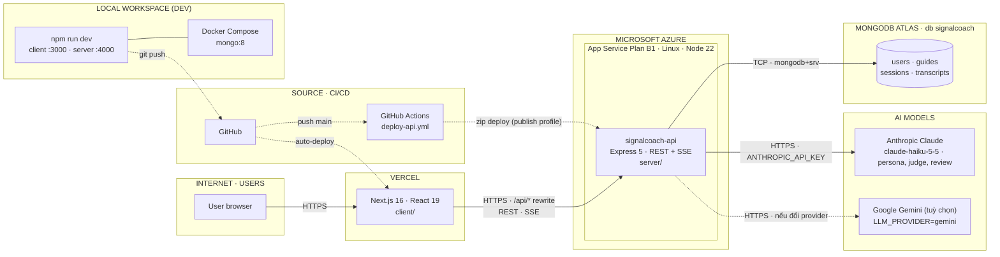
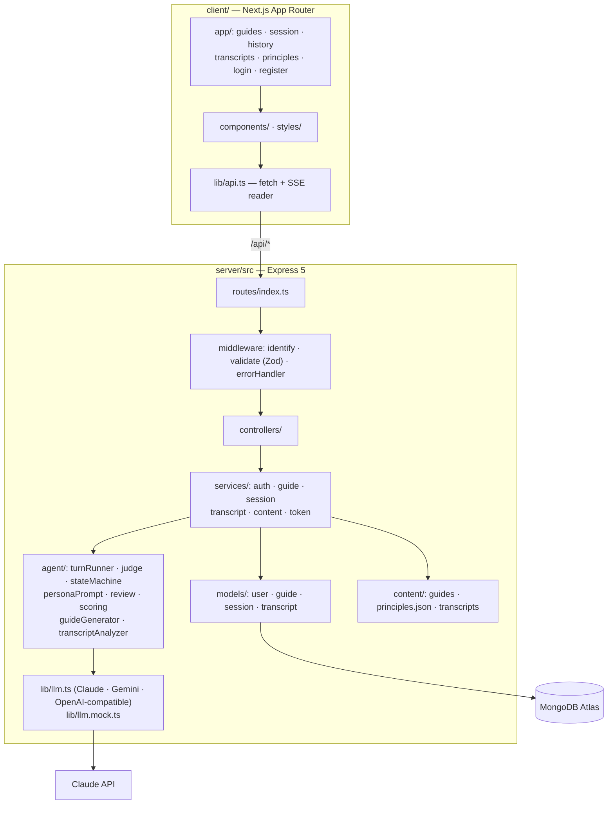
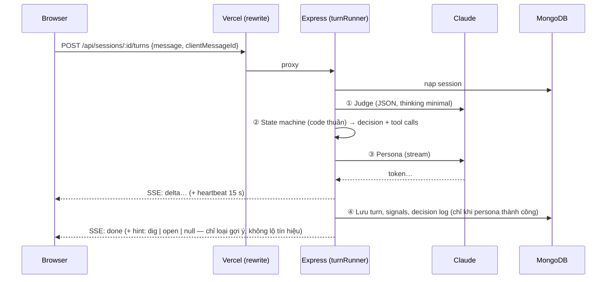

# SignalCoach — Kiến trúc hệ thống

SignalCoach là agent đóng vai người được phỏng vấn để người dùng luyện kỹ năng phỏng vấn người dùng
(user interview). Tài liệu này mô tả kiến trúc **vật lý** (hạ tầng, nơi chạy, luồng kết nối) và kiến
trúc **logic** (thành phần mã nguồn, dữ liệu). Cơ chế bên trong agent xem [AGENT.md](AGENT.md); hướng
dẫn triển khai từng bước xem [DEPLOY.md](DEPLOY.md).

---

## 1. Kiến trúc vật lý

Quy ước nét vẽ: **nét liền** = luồng chạy thật (HTTPS / TCP); **nét đứt** = build / deploy.

### 1.1 Các khối triển khai

| Khối | Nơi chạy | Công nghệ | Vai trò |
|---|---|---|---|
| User browser | Máy người dùng | Trình duyệt hiện đại | Giao diện tiếng Việt; chỉ nói chuyện với origin Vercel, không giữ API key nào |
| Web (`client/`) | **Vercel** | Next.js 16 (`cacheComponents`), React 19 | Render các màn hình S01–S15; **proxy `/api/*` sang Azure** bằng rewrite (đọc `API_ORIGIN` lúc build) |
| API (`server/`) | **Azure App Service** B1, Linux, Node ≥ 22, *Always On* | Express 5, Mongoose 9, Zod, pino, helmet | REST + SSE, xác thực JWT cookie, chạy agent, gọi LLM |
| Database | **MongoDB Atlas** (cluster dùng chung `docstack`, db `signalcoach`) | MongoDB | Lưu user, guide, session, transcript |
| LLM | **Anthropic Claude API** — Claude Haiku 5.5 (từ 27/10/2026) | `@anthropic-ai/sdk` (`@google/genai` vẫn dùng được qua `LLM_PROVIDER=gemini`) | Persona (stream), Judge (JSON), Review (thinking `low`) |
| CI/CD | **GitHub + GitHub Actions** | `deploy-api.yml` | Push `main` → build → zip deploy lên Azure; Vercel tự deploy `client/` khi push |
| Dev cục bộ | Máy lập trình viên | Docker Compose (`mongo:8`) hoặc `npm run db:memory`; `LLM_PROVIDER=mock` chạy offline | Chạy toàn bộ stack không cần mạng |

### 1.2 Quyết định hạ tầng quan trọng

- **Một origin duy nhất cho trình duyệt.** Vercel rewrite `/api/*` → Azure nên cookie xác thực là
  first-party (`SameSite=Lax`), **không cần CORS** (`CORS_ORIGINS` để trống). Phương án dự phòng nếu
  proxy làm đệm/ngắt SSE: gọi thẳng Azure với `COOKIE_SAMESITE=none` (xem DEPLOY.md).
- **SSE chịu được lời gọi LLM dài.** Azure ngắt kết nối nhàn rỗi sau ~230 s; server gửi heartbeat mỗi
  15 s và đặt `Cache-Control: no-cache, no-transform` để proxy không đệm luồng (`utils/sse.ts`).
- **Khoá LLM chỉ nằm ở server.** Production dùng `ANTHROPIC_API_KEY` (App Settings). Khi chạy
  Gemini, `GEMINI_API_KEYS` là danh sách phân tách bằng dấu phẩy, gặp 401/403/429 thì tự chuyển sang
  khoá dự phòng; model lỗi 503/404 thì đi theo chuỗi `LLM_MODEL_FALLBACKS`.
- **Khách vãng lai dùng được ngay (FR-12).** Middleware `identify` cấp *anon token* (180 ngày); đăng
  ký sau thì dữ liệu cũ được gắn vào tài khoản.
- **Triển khai bằng gói build sẵn** (`dist/` + `node_modules` production) nên App Service không build
  (`SCM_DO_BUILD_DURING_DEPLOYMENT=false`). Health check: `/api/health`.
- **Không có Redis, queue hay thanh toán.** Trạng thái phiên nằm trong MongoDB; mỗi lượt chat là một
  request SSE độc lập và idempotent theo `clientMessageId`.

### 1.3 Cấu hình theo môi trường

| Biến | Local | Production (Azure) |
|---|---|---|
| `MONGODB_URI` | `mongodb://localhost:27017` hoặc Atlas | Atlas `mongodb+srv://…` |
| `LLM_PROVIDER` | `mock`, `anthropic` hoặc `gemini` | `anthropic` (`mock` bị từ chối khi `NODE_ENV=production`) |
| `COOKIE_SECURE` / `TRUST_PROXY` | `false` / `0` | `true` / `1` |
| `API_ORIGIN` (Vercel) | — (Next dev rewrite về `localhost:4000`) | `https://<app>.azurewebsites.net` |

---

## 2. Kiến trúc logic

### 2.1 API (tiền tố `/api`)

| Nhóm | Endpoint | Ghi chú |
|---|---|---|
| Hệ thống | `GET /health`, `GET /principles` | health trả `status` + trạng thái DB |
| Auth | `POST /auth/register · login · logout`, `GET /auth/me` | JWT trong cookie `sc_token` |
| Guide | `GET/POST /guides`, `POST /guides/generate`, `GET/DELETE /guides/:id` | 3 guide có sẵn + guide tự sinh bằng LLM theo người dùng |
| Session | `GET/POST/DELETE /sessions`, `GET/DELETE /sessions/:id` | khách vãng lai dùng được |
| | `POST /sessions/:id/turns` | **SSE**: stream lời persona + sự kiện trạng thái |
| | `POST /sessions/:id/end`, `POST /sessions/:id/scorecard` | đóng buổi, review + self-check, tạo scorecard |
| Transcript | `GET /transcripts/samples`, `GET/POST /transcripts`, `GET/DELETE /transcripts/:id` | phân tích transcript phỏng vấn thật |

### 2.2 Luồng một lượt chat

Nguyên tắc: **LLM đề xuất, code quyết định** — chi tiết ở [AGENT.md](AGENT.md).

### 2.3 Mô hình LLM theo vai

Production chạy `LLM_PROVIDER=anthropic`: cả ba vai dùng **Claude Haiku 5.5** (`claude-haiku-5-5`).

| Vai | Thinking (`LLM_REASONING_*`) | Mục tiêu |
|---|---|---|
| Persona | `minimal` | token đầu nhanh (NFR-1: ≤ 3 s) |
| Judge | `minimal` | JSON ngắn, kiểm bằng Zod, sai gọi lại 1 lần |
| Review | `low` | đọc toàn bộ hội thoại cuối buổi, sau đó self-check bằng code; `high` làm JSON chậm/rỗng |

Với `LLM_PROVIDER=gemini` các mặc định là `gemini-3.5-flash` (persona, review), `gemini-3.5-flash-lite`
(judge) và chuỗi fallback `LLM_MODEL_FALLBACKS` khi model chính lỗi 503/404.

### 2.4 Dữ liệu (MongoDB, db `signalcoach`)

| Collection | Nội dung chính |
|---|---|
| `users` | email, password hash (bcryptjs) |
| `guides` | chủ đề, persona, danh sách 18 tín hiệu × 3 lớp; guide tự sinh có chủ sở hữu |
| `sessions` | guide snapshot, `turns[]` (kèm `decision`, `toolCalls`), `signals[]` (status, layer, cửa sổ, evidence, confidence), `revealedFacts[]`, scorecard, `selfCheckLog` |
| `transcripts` | bản phân tích transcript phỏng vấn thật |

Nội dung tĩnh (guide có sẵn, `principles.json`, transcript mẫu) nằm trong `server/content/` và được
đóng gói cùng bản deploy.

### 2.5 Bảo mật & độ tin cậy

- `helmet`, cookie `HttpOnly`, `SameSite=Lax`, `Secure` ở production; JWT secret ≥ 32 ký tự.
- Mọi body/params qua Zod (`middleware/validate.ts`); env được kiểm tra khi khởi động, sai thì thoát
  kèm danh sách lỗi.
- Prompt persona **chỉ chứa lớp tín hiệu đã kể**, nên jailbreak cũng không có gì để lộ.
- Lưu trạng thái sau khi persona thành công + `clientMessageId` ⇒ thử lại an toàn khi mất mạng.
- Log có cấu trúc bằng `pino` (xem **Log stream** trên Azure).

---

## 3. Vì sao chọn Next.js

Backend tách riêng bằng Express, nên Next.js ở đây làm phần giao diện và một lớp proxy mỏng. Vẫn chọn
Next.js vì:

- **Cùng origin cho cookie `httpOnly`.** Rewrite `/api/*` → Azure (`next.config.ts`) làm trình duyệt chỉ
  thấy một origin. Cookie đăng nhập là first-party, `SameSite=Lax`, không cần CORS và không phải để
  token trong JavaScript. Làm SPA thuần trên một host tĩnh thì phải tự dựng proxy này hoặc chuyển sang
  cookie cross-site (`SameSite=None`), dễ bị trình duyệt chặn.
- **App Router cho các trang.** Mỗi màn hình là một route thật (`/`, `/guides/[guideId]`,
  `/session/[sessionId]`, `/session/[sessionId]/scorecard`, `/session/[sessionId]/review`, `/history`,
  `/transcripts/[id]`, `/principles`…): link chia sẻ được, nút back hoạt động, mỗi trang tách bundle
  riêng; vỏ trang được prerender (`cacheComponents`) nên hiện ngay rồi mới nạp dữ liệu.
- **Vercel.** Push là deploy, có preview cho từng nhánh, không phải quản lý server cho phần giao diện.

Chưa dùng Route Handlers hay Server Components để gọi dữ liệu: mọi logic và khoá LLM nằm ở Express. Chỉ
đổi kiến trúc nếu có lý do khác (ví dụ bỏ hẳn Express).

---

## 4. Triển khai hiện tại và điểm cần làm tiếp

Đã triển khai: API chạy trên Azure Web App `signalcoach-api` (resource group `mitsu`,
`LLM_PROVIDER=anthropic`), client chạy trên Vercel (`API_ORIGIN` trỏ về Azure). Những chỗ dễ vấp khi
deploy API:

- **Đóng gói `api.zip` bằng `tar.exe` của Windows** (`C:/Windows/System32/tar.exe -a -cf api.zip …`),
  không dùng `tar` của Git Bash: GNU tar tạo file tar thường mang đuôi `.zip`, OneDeploy báo "thành công"
  trong 2 giây mà không giải nén. Kiểm tra lại bằng `file api.zip` (phải là Zip).
- **Deploy bằng `az webapp deploy --type zip --clean true`** để xoá `node_modules.tar.gz` /
  `oryx-manifest.toml` cũ trong `wwwroot` (script khởi động sẽ giải nén đè lên `node_modules` mới).
- **Deploy code trước, đổi App Settings sau** khi settings mới cần code mới (ví dụ đổi
  `LLM_PROVIDER`).
- **Restart thủ công sau khi đổi settings** (`az webapp restart`): đổi settings không phải lúc nào cũng
  tự khởi động lại app.

Còn lại:

- Kiểm tra theo checklist SM-4 trong DEPLOY.md sau mỗi lần deploy.
- Giới hạn Atlas Network Access theo outbound IP của App Service thay vì `0.0.0.0/0`.
- RAG (nếu làm): dùng Atlas Vector Search trên cùng cluster, không cần đổi kết nối.
